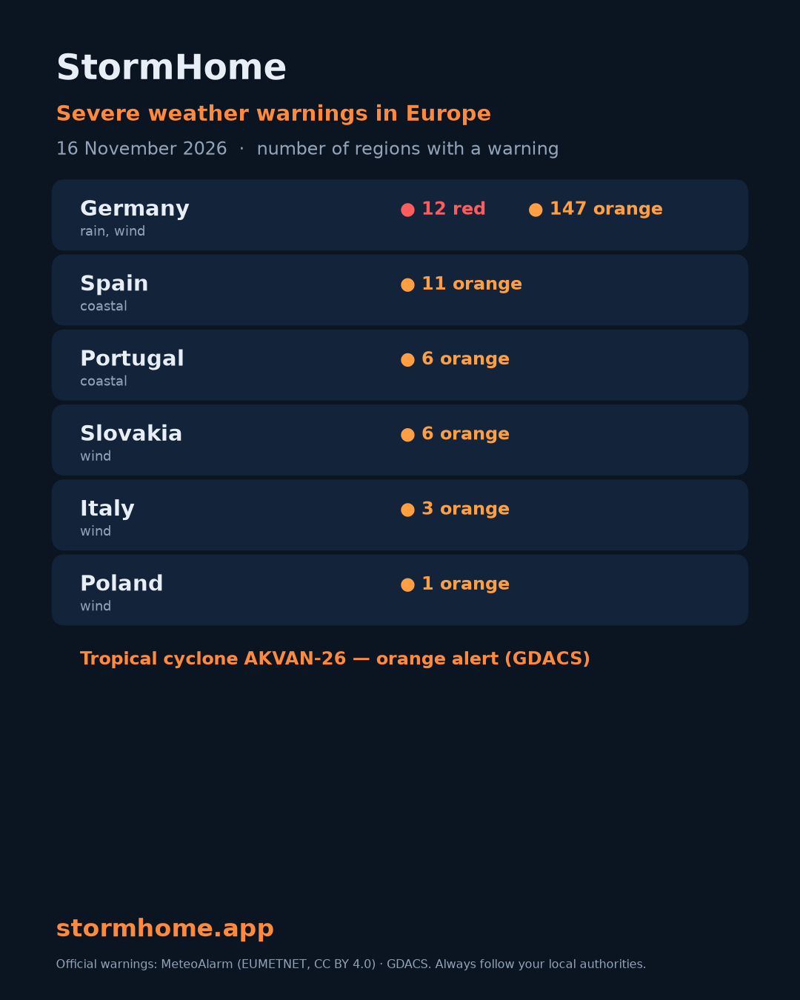
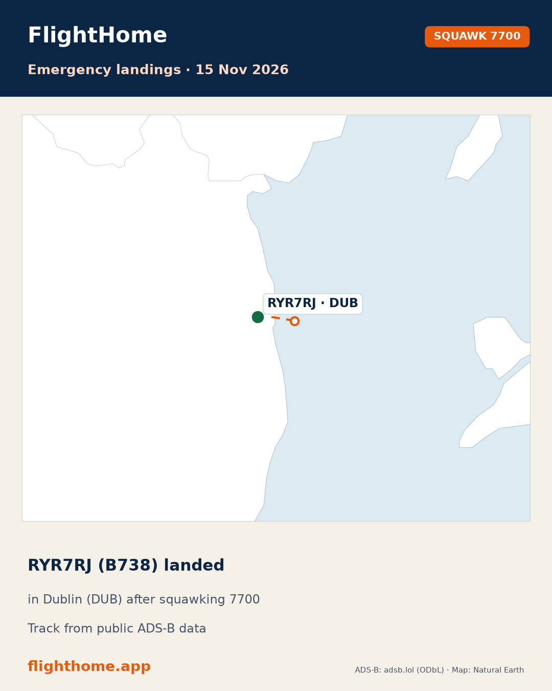
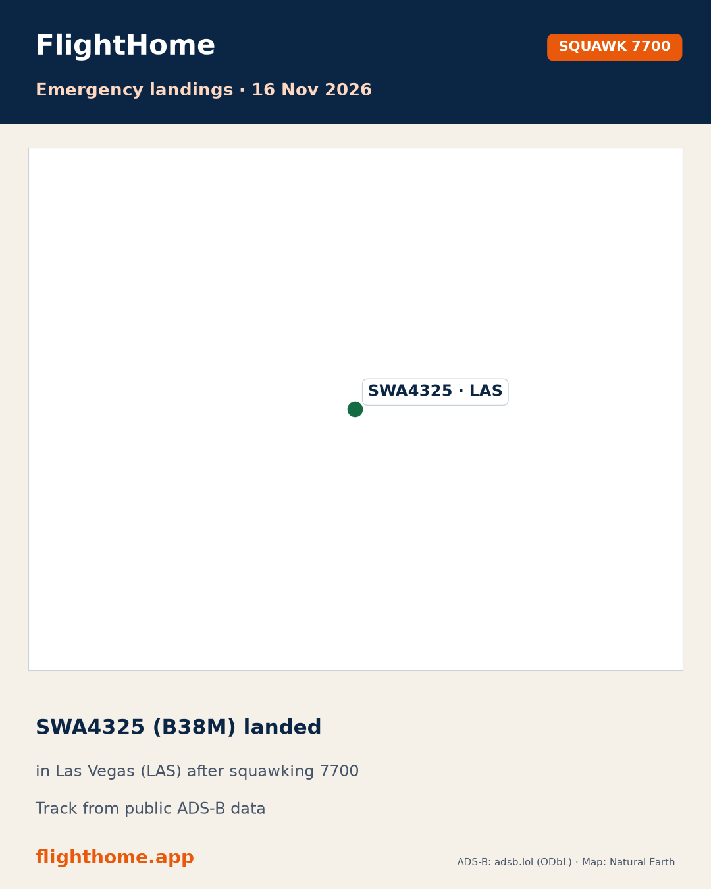

# Exemplos do robô de redes sociais

Gerado a 16/11/2026 23:39 (hora de Lisboa) com dados reais. **Nada foi publicado.**

## SwimHeat — provas da semana
- **Quando:** segunda-feira 19:00
- **Onde:** Facebook + Instagram
- **Imagem:** https://lusoapps.com/social/fotos/subaquatica-nadador.jpg ✅


```
🏊 Esta semana no SwimHeat · seg 16–dom 22 nov

🇵🇹 Portugal
• sáb 21–dom 22 nov · Leiria — Campeonato Distrital PC + TD Fundo Juv + TNCompleto Inf (25m)

🇪🇸 España
• sáb 21 nov · Logroño — XXVI Trofeo Ciudad de Logroño 26-27 (25m)

⏰ dom 22 nov: último dia para os mínimos dos Zonais de Juvenis

Segue o teu nadador ao vivo: provas, tempos, lugares e mínimos no telemóvel. Grátis.
Sigue a tu nadador en directo · Follow your swimmer live.
📲 swimheat.app (link na bio)

#natação #natacion #swimming #SwimHeat
```

## SwimHeat — resumo de domingo
- **Quando:** domingo 21:00
- **Onde:** Facebook + Instagram
- **Imagem:** https://lusoapps.com/social/fotos/livres-de-cima.jpg ✅
- **Nota:** Só números, nunca nomes. 'Melhor tempo da época' compara com os tempos desta época que o SwimHeat tem (só Portugal).


```
📊 O fim de semana em números · sáb 14–dom 15 nov

🇵🇹 4 provas (Coimbra, Peso da Régua, Ponte da Barca, Tomar)
   432 nadadores · 43 clubes · 2021 tempos individuais
   ⚡ 226 vezes um nadador bateu o seu melhor tempo da época
🇪🇸 3 competiciones (Barcelona, Navia)
   468 nadadores · 38 clubes · 831 tiempos individuales

Todos os resultados, parciais e recordes pessoais na app. Grátis.
Todos los resultados en la app · All results in the app.
📲 swimheat.app (link na bio)

#natação #natacion #swimming #SwimHeat
```

## StormHome — avisos
- **Quando:** todos os dias às 08:00 (só se houver laranja/vermelho ou ciclone)
- **Onde:** Facebook + Instagram
- **Imagem:** out/2026-11-16/stormhome.png



```
⚠️ Severe weather warnings in Europe · 16 Nov

• Germany: 🔴 12 red · 🟠 147 orange — rain, wind
• Spain: 🟠 11 orange — coastal
• Portugal: 🟠 6 orange — coastal
• Slovakia: 🟠 6 orange — wind
• Italy: 🟠 3 orange — wind
• Poland: 🟠 1 orange — wind
🌀 Tropical cyclone AKVAN-26 — orange alert (GDACS)
(number of regions with a warning)

🇵🇹 Avisos laranja e vermelhos na Europa hoje:
• Alemanha: 🔴 12 · 🟠 147 — chuva, vento
• Espanha: 🟠 11 — agitação marítima
• Portugal: 🟠 6 — agitação marítima
• Eslováquia: 🟠 6 — vento
• Itália: 🟠 3 — vento
• Polónia: 🟠 1 — vento

Official warnings on a live map, alerts for your area and your trip: stormhome.app (link in bio)
Avisos oficiais no mapa e alertas para a tua zona e para a tua viagem.

Sources: MeteoAlarm (EUMETNET, CC BY 4.0), GDACS. Always follow your local authorities and weather service.

#StormHome #weather #severeweather #meteo
```

## FlightHome — aterragens de emergência (7700) de 2026-11-15
- **Quando:** todos os dias às 09:00 (só se houver casos)
- **Onde:** Facebook + Instagram
- **Imagem:** out/2026-11-15/flighthome.png
- **Nota:** 7 aviões no registo do dia; 1 com 7700, vistos 2+ vezes e parados a menos de 15 km de um aeroporto. Percurso no mapa: só o primeiro e o último ponto (linha tracejada).



```
✈️ Emergency landings · 15 Nov 2026

• RYR7RJ (B738) squawked 7700 and landed in Dublin (DUB)

Squawk 7700 asks air traffic control for priority — for medical, technical or precautionary reasons. We don't know the cause of each case.

🇵🇹 Aterragens de emergência · 15 nov
• RYR7RJ (B738) declarou 7700 e aterrou em Dublin (DUB)
O código 7700 pede prioridade ao controlo aéreo — por razões médicas, técnicas ou por precaução. Não sabemos a causa de cada caso.

Follow flights live · Segue os voos ao vivo: flighthome.app (link in bio)
Public ADS-B data: adsb.lol (ODbL).

#FlightHome #aviation #avgeek #squawk7700
```

## FlightHome — aterragens de emergência (7700) de hoje, 2026-11-16 (até agora)
- **Quando:** todos os dias às 09:00 (só se houver casos)
- **Onde:** Facebook + Instagram
- **Imagem:** out/2026-11-16/flighthome.png
- **Nota:** 9 aviões no registo do dia; 1 com 7700, vistos 2+ vezes e parados a menos de 15 km de um aeroporto. Percurso no mapa: só o primeiro e o último ponto (linha tracejada).



```
✈️ Emergency landings · 16 Nov 2026

• SWA4325 (B38M) squawked 7700 and landed in Las Vegas (LAS)

Squawk 7700 asks air traffic control for priority — for medical, technical or precautionary reasons. We don't know the cause of each case.

🇵🇹 Aterragens de emergência · 16 nov
• SWA4325 (B38M) declarou 7700 e aterrou em Las Vegas (LAS)
O código 7700 pede prioridade ao controlo aéreo — por razões médicas, técnicas ou por precaução. Não sabemos a causa de cada caso.

Follow flights live · Segue os voos ao vivo: flighthome.app (link in bio)
Public ADS-B data: adsb.lol (ODbL).

#FlightHome #aviation #avgeek #squawk7700
```
