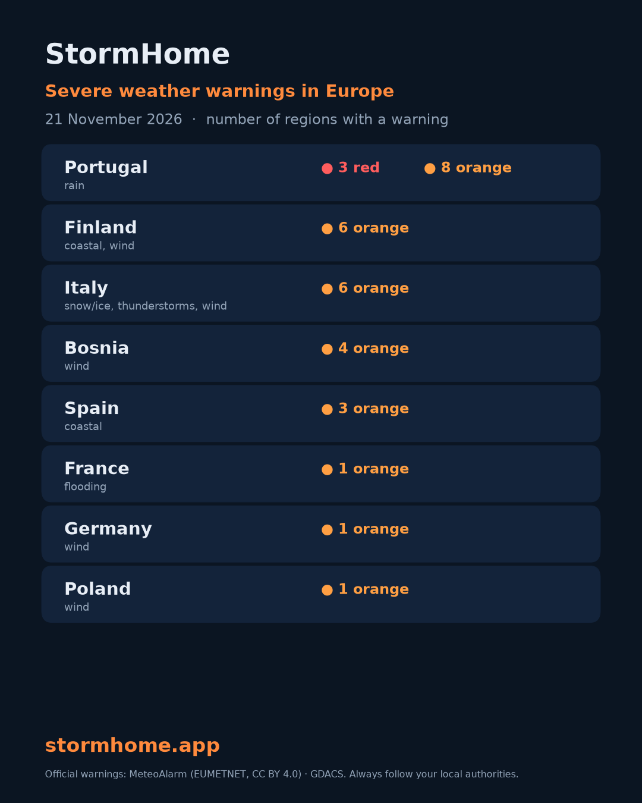
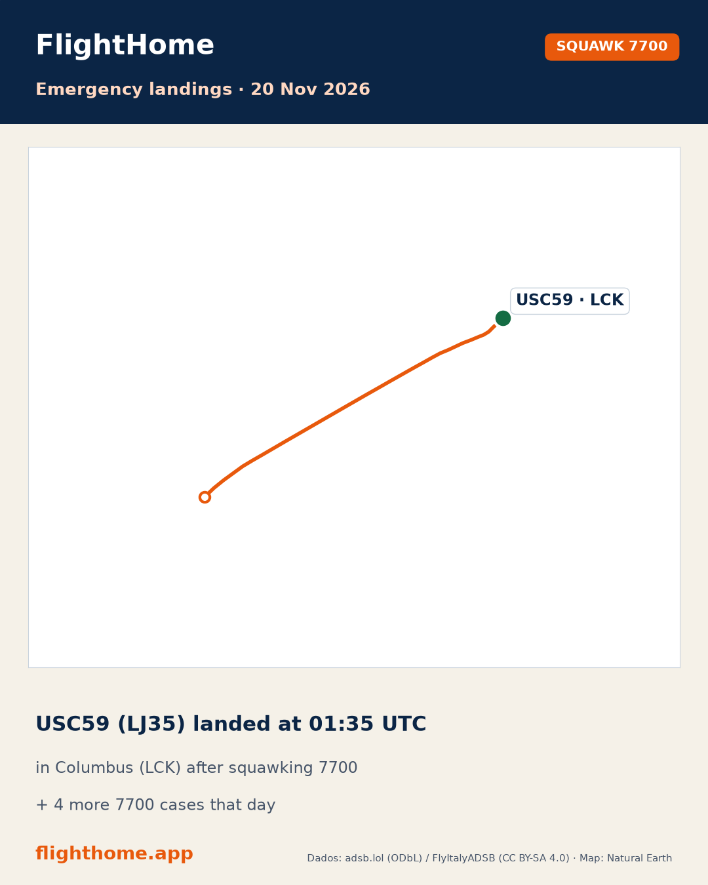

# Exemplos do robô de redes sociais

Gerado a 21/11/2026 09:32 (hora de Lisboa) com dados reais. **Nada foi publicado.**

## SwimHeat — provas da semana
- **Quando:** segunda-feira 19:00
- **Onde:** Facebook + Instagram
- **Imagem:** https://lusoapps.com/social/fotos/subaquatica-nadador.jpg ✅


```
🏊 Esta semana no SwimHeat · seg 16–dom 22 nov

🇵🇹 Portugal
• sex 20–dom 22 nov · Braga — Campeonato Territorial JUV, JUN e SEN / Torneio de Fundo de Juvenis (25m)
• sáb 21–dom 22 nov · Bragança — Campeonatos Regionais de Juv., Jun. e Sen | PP INF | Torregri I Cadetes A (25m)
• sáb 21–dom 22 nov · Cantanhede — Campeonato Regional de Juvenis, Juniores e Seniores - Piscina Curta (25m)
• sáb 21 nov · Castelo Branco — Campeonatos Nacionais Universitarios Natação PC (25m)
• sáb 21–dom 22 nov · Guarda — Campeonato Regional ANICentro e Preparação de Infantis (25m)
• sáb 21–dom 22 nov · Leiria — Campeonato Distrital PC + TD Fundo Juv + TNCompleto Inf (25m)
• sáb 21–dom 22 nov · Sines — CR Juvenis e Absolutos & TR Fundo Juvenis & TN Completo Infantis (25m)
• sáb 21–dom 22 nov · Vila Real de Santo António — Campeonato Regional de Juvenis, Juniores, Seniores e Adaptada (25m)

🇪🇸 España
• sáb 21 nov · Logroño — XXVI Trofeo Ciudad de Logroño 26-27 (25m)
• dom 22 nov · Barcelona — Campionat de Catalunya Universitari (25m)

⏰ dom 22 nov: último dia para os mínimos dos Zonais de Juvenis

Segue o teu nadador ao vivo: provas, tempos, lugares e mínimos no telemóvel. Grátis.
Sigue a tu nadador en directo · Follow your swimmer live.
📲 swimheat.app (link na bio)

#natação #natacion #swimming #SwimHeat
```

## SwimHeat — resumo de domingo
- **Quando:** domingo 21:00
- **Onde:** Facebook + Instagram
- **Imagem:** https://lusoapps.com/social/fotos/livres-de-cima.jpg ✅
- **Nota:** Só números, nunca nomes. 'Melhor tempo da época' compara com os tempos desta época que o SwimHeat tem (só Portugal).


```
📊 O fim de semana em números · sáb 14–dom 15 nov

🇵🇹 4 provas (Coimbra, Peso da Régua, Ponte da Barca, Tomar)
   432 nadadores · 43 clubes · 2021 tempos individuais
   ⚡ 237 vezes um nadador bateu o seu melhor tempo da época
🇪🇸 5 competiciones (Barcelona, Navia, Vilafranca del Penedès, Águilas)
   759 nadadores · 57 clubes · 1316 tiempos individuales

Todos os resultados, parciais e recordes pessoais na app. Grátis.
Todos los resultados en la app · All results in the app.
📲 swimheat.app (link na bio)

#natação #natacion #swimming #SwimHeat
```

## StormHome — avisos
- **Quando:** todos os dias às 08:00 (só se houver laranja/vermelho ou ciclone)
- **Onde:** Facebook + Instagram
- **Imagem:** out/2026-11-21/stormhome.png



```
⚠️ Severe weather warnings in Europe · 21 Nov

• Portugal: 🔴 3 red · 🟠 8 orange — rain
• Finland: 🟠 6 orange — coastal, wind
• Italy: 🟠 6 orange — snow/ice, thunderstorms, wind
• Bosnia: 🟠 4 orange — wind
• Spain: 🟠 3 orange — coastal
• France: 🟠 1 orange — flooding
• Germany: 🟠 1 orange — wind
• Poland: 🟠 1 orange — wind
(number of regions with a warning)

🇵🇹 Avisos laranja e vermelhos na Europa hoje:
• Portugal: 🔴 3 · 🟠 8 — chuva
• Finlândia: 🟠 6 — agitação marítima, vento
• Itália: 🟠 6 — neve/gelo, trovoada, vento
• Bósnia: 🟠 4 — vento
• Espanha: 🟠 3 — agitação marítima
• França: 🟠 1 — cheias
• Alemanha: 🟠 1 — vento
• Polónia: 🟠 1 — vento

Official warnings on a live map, alerts for your area and your trip: stormhome.app (link in bio)
Avisos oficiais no mapa e alertas para a tua zona e para a tua viagem.

Sources: MeteoAlarm (EUMETNET, CC BY 4.0), GDACS. Always follow your local authorities and weather service.

#StormHome #weather #severeweather #meteo
```

## FlightHome — aterragens de emergência (7700) de 2026-11-20
- **Quando:** todos os dias às 09:00 (só se houver casos)
- **Onde:** Facebook + Instagram
- **Imagem:** out/2026-11-20/flighthome.png
- **Nota:** 20 aviões no registo do dia; 5 com 7700, vistos 2+ vezes e terminados a menos de 15 km de um aeroporto (3 com sinal perdido na aproximação = aterragem não confirmada). Casos militares só entram depois do fim. Percurso no mapa: completo. Fonte: Dados: adsb.lol (ODbL) / FlyItalyADSB (CC BY-SA 4.0).



```
✈️ Emergency landings · 20 Nov 2026

• USC59 (LJ35) squawked 7700 and landed at 01:35 UTC in Columbus (LCK)
• EZY27CF (A320) squawked 7700 and landed at 19:12 UTC in Amsterdam (AMS)
• SRD224B (BE30) squawked 7700 and was followed to the final approach to Humberside Airport at 12:54 UTC — landing not confirmed
• FJGNB (SHRK) squawked 7700 and was followed to the final approach to Grenoble-Isère Airport at 15:30 UTC — landing not confirmed
• N79172 (C172) squawked 7700 and was followed to the final approach to La Crosse Municipal Airport at 16:35 UTC — landing not confirmed

Squawk 7700 asks air traffic control for priority — for medical, technical or precautionary reasons. We don't know the cause of each case.

🇵🇹 Aterragens de emergência · 20 nov
• USC59 (LJ35) declarou 7700 e aterrou às 01:35 UTC em Columbus (LCK)
• EZY27CF (A320) declarou 7700 e aterrou às 19:12 UTC em Amsterdam (AMS)
• SRD224B (BE30) declarou 7700 e foi seguido até à aproximação final a Humberside Airport às 12:54 UTC — aterragem não confirmada
• FJGNB (SHRK) declarou 7700 e foi seguido até à aproximação final a Grenoble-Isère Airport às 15:30 UTC — aterragem não confirmada
• N79172 (C172) declarou 7700 e foi seguido até à aproximação final a La Crosse Municipal Airport às 16:35 UTC — aterragem não confirmada
O código 7700 pede prioridade ao controlo aéreo — por razões médicas, técnicas ou por precaução. Não sabemos a causa de cada caso.

Follow flights live · Segue os voos ao vivo: flighthome.app (link in bio)
Dados: adsb.lol (ODbL) / FlyItalyADSB (CC BY-SA 4.0).

#FlightHome #aviation #avgeek #squawk7700
```

## FlightHome — aterragens de emergência (7700) de hoje, 2026-11-21 (até agora)
_Hoje não publicaria nada (sem conteúdo para este tipo de publicação)._
