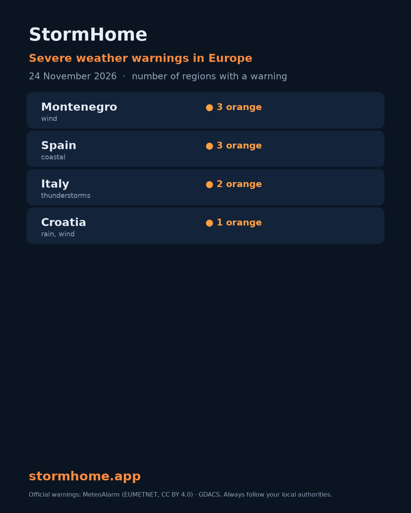
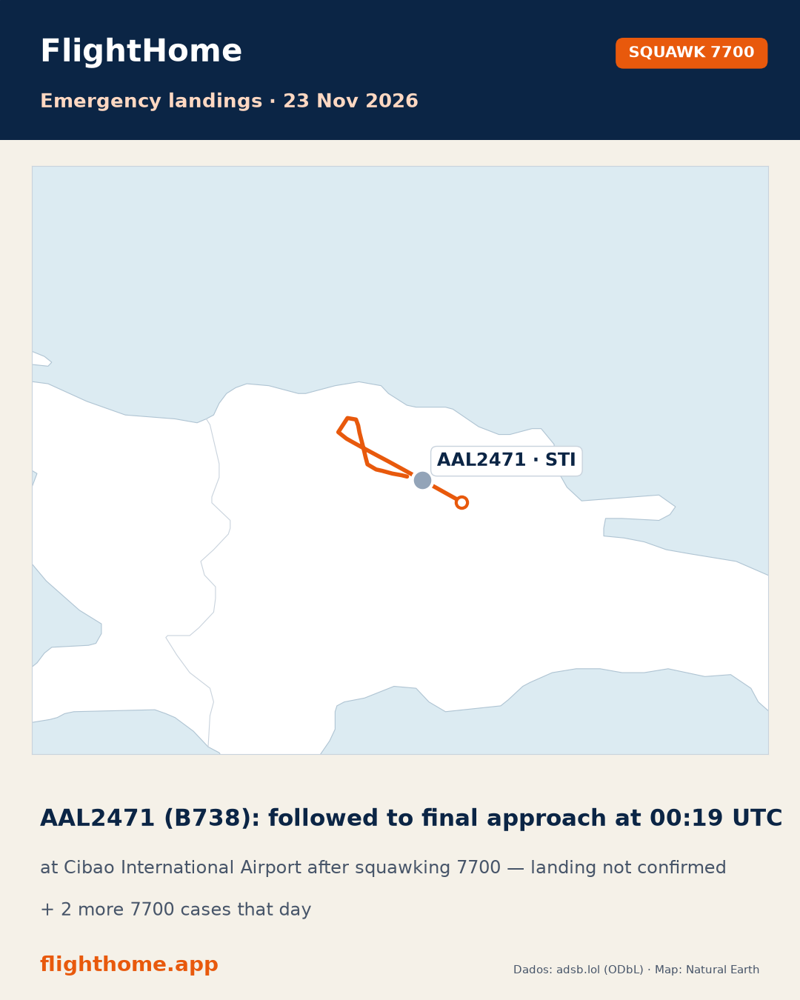
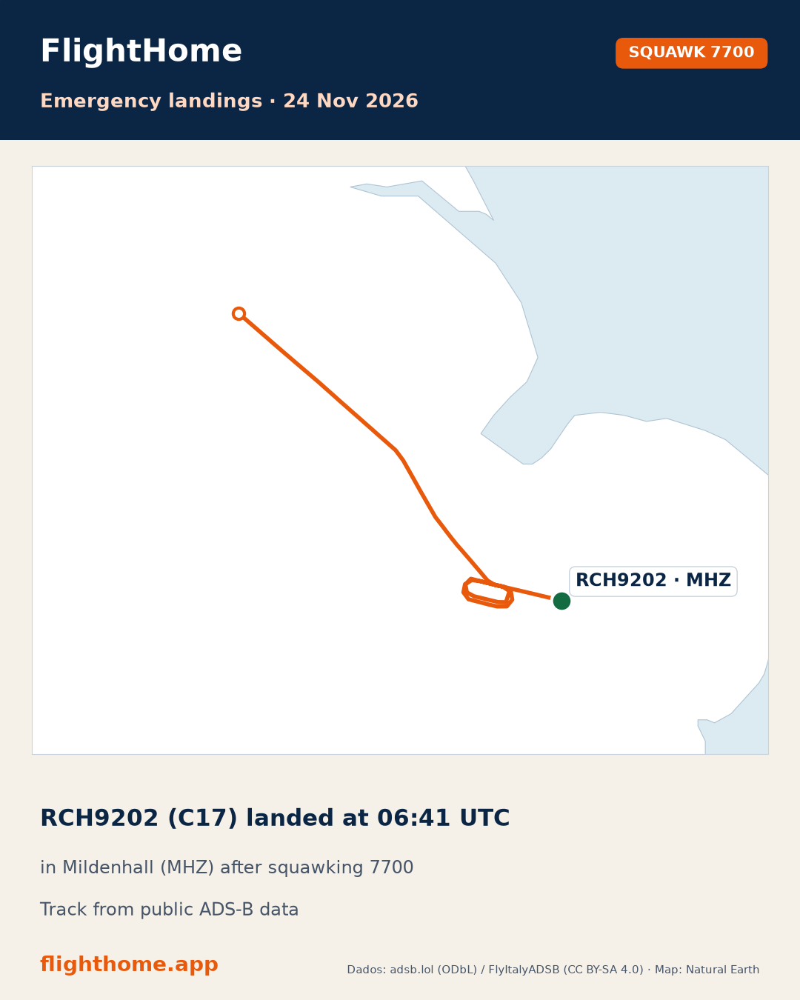

# Exemplos do robô de redes sociais

Gerado a 24/11/2026 10:45 (hora de Lisboa) com dados reais. **Nada foi publicado.**

## SwimHeat — provas da semana
- **Quando:** segunda-feira 19:00
- **Onde:** Facebook + Instagram
- **Imagem:** https://lusoapps.com/social/fotos/mariposa-prova.jpg ✅


```
🏊 Esta semana no SwimHeat · seg 23–dom 29 nov

🇵🇹 Portugal
• sex 27 nov · Mealhada — Campeonato Nacional Clubes 3ª Divisão (25m)
• sáb 28–dom 29 nov · Mealhada — Campeonato Nacional Clubes 2ª Divisão (25m)
• dom 29 nov · Coruche — 1º Torregi de Cadetes- 2ºTorneio de Cadetes (25m)

🇪🇸 España
• sáb 28–dom 29 nov · Gijón — V Copa de Clubes de Asturias Absoluta (25m)

Segue o teu nadador ao vivo: provas, tempos, lugares e mínimos no telemóvel. Grátis.
Sigue a tu nadador en directo · Follow your swimmer live.
📲 swimheat.app (link na bio)

#natação #natacion #swimming #SwimHeat
```

## SwimHeat — resumo de domingo
- **Quando:** domingo 21:00
- **Onde:** Facebook + Instagram
- **Imagem:** https://lusoapps.com/social/fotos/mariposa-escuro.jpg ✅
- **Nota:** Só números, nunca nomes. 'Melhor tempo da época' compara com os tempos desta época que o SwimHeat tem (só Portugal).


```
📊 O fim de semana em números · sáb 21–dom 22 nov

🇵🇹 8 provas (Braga, Bragança, Cantanhede, Castelo Branco, Guarda, Leiria, Sines, Vila Real de Santo António)
   1224 nadadores · 95 clubes · 5292 tempos individuais
   ⚡ 1026 vezes um nadador bateu o seu melhor tempo da época
🇪🇸 4 competiciones (Barcelona, Logroño, Oviedo, Águilas)
   1188 nadadores · 62 clubes · 2531 tiempos individuales

Todos os resultados, parciais e recordes pessoais na app. Grátis.
Todos los resultados en la app · All results in the app.
📲 swimheat.app (link na bio)

#natação #natacion #swimming #SwimHeat
```

## StormHome — avisos
- **Quando:** todos os dias às 08:00 (só se houver laranja/vermelho ou ciclone)
- **Onde:** Facebook + Instagram
- **Imagem:** out/2026-11-24/stormhome.png



```
⚠️ Severe weather warnings in Europe · 24 Nov

• Montenegro: 🟠 3 orange — wind
• Spain: 🟠 3 orange — coastal
• Italy: 🟠 2 orange — thunderstorms
• Croatia: 🟠 1 orange — rain, wind
(number of regions with a warning)

🇵🇹 Avisos laranja e vermelhos na Europa hoje:
• Montenegro: 🟠 3 — vento
• Espanha: 🟠 3 — agitação marítima
• Itália: 🟠 2 — trovoada
• Croácia: 🟠 1 — chuva, vento

Official warnings on a live map, alerts for your area and your trip: stormhome.app (link in bio)
Avisos oficiais no mapa e alertas para a tua zona e para a tua viagem.

Sources: MeteoAlarm (EUMETNET, CC BY 4.0), GDACS. Always follow your local authorities and weather service.

#StormHome #weather #severeweather #meteo
```

## FlightHome — aterragens de emergência (7700) de 2026-11-23
- **Quando:** todos os dias às 09:00 (só se houver casos)
- **Onde:** Facebook + Instagram
- **Imagem:** out/2026-11-23/flighthome.png
- **Nota:** 23 aviões no registo do dia; 3 com 7700, vistos 2+ vezes e terminados a menos de 15 km de um aeroporto (1 com sinal perdido na aproximação = aterragem não confirmada). Casos militares só entram depois do fim. Percurso no mapa: completo. Fonte: Dados: adsb.lol (ODbL) / FlyItalyADSB (CC BY-SA 4.0).



```
✈️ Emergency landings · 23 Nov 2026

• NHZ790 (EC75) squawked 7700 and landed in Aberdeen (ABZ) — seen on the ground at 11:32 UTC
• USC59 (LJ35) squawked 7700 and landed in Columbus (LCK) — seen on the ground at 18:33 UTC
• AAL2471 (B738) squawked 7700 and was followed to the final approach to Cibao International Airport at 00:19 UTC — landing not confirmed

Squawk 7700 asks air traffic control for priority — for medical, technical or precautionary reasons. We don't know the cause of each case.

🇵🇹 Aterragens de emergência · 23 nov
• NHZ790 (EC75) declarou 7700 e aterrou em Aberdeen (ABZ) — visto no chão às 11:32 UTC
• USC59 (LJ35) declarou 7700 e aterrou em Columbus (LCK) — visto no chão às 18:33 UTC
• AAL2471 (B738) declarou 7700 e foi seguido até à aproximação final a Cibao International Airport às 00:19 UTC — aterragem não confirmada
O código 7700 pede prioridade ao controlo aéreo — por razões médicas, técnicas ou por precaução. Não sabemos a causa de cada caso.

Follow flights live · Segue os voos ao vivo: flighthome.app (link in bio)
Dados: adsb.lol (ODbL) / FlyItalyADSB (CC BY-SA 4.0).

#FlightHome #aviation #avgeek #squawk7700
```

## FlightHome — aterragens de emergência (7700) de hoje, 2026-11-24 (até agora)
- **Quando:** todos os dias às 09:00 (só se houver casos)
- **Onde:** Facebook + Instagram
- **Imagem:** out/2026-11-24/flighthome.png
- **Nota:** 10 aviões no registo do dia; 1 com 7700, vistos 2+ vezes e terminados a menos de 15 km de um aeroporto (0 com sinal perdido na aproximação = aterragem não confirmada). Casos militares só entram depois do fim. Percurso no mapa: completo. Fonte: Dados: adsb.lol (ODbL) / FlyItalyADSB (CC BY-SA 4.0).



```
✈️ Emergency landings · 24 Nov 2026

• RCH9202 (C17) squawked 7700 and landed at 06:41 UTC in Mildenhall (MHZ)

Squawk 7700 asks air traffic control for priority — for medical, technical or precautionary reasons. We don't know the cause of each case.

🇵🇹 Aterragens de emergência · 24 nov
• RCH9202 (C17) declarou 7700 e aterrou às 06:41 UTC em Mildenhall (MHZ)
O código 7700 pede prioridade ao controlo aéreo — por razões médicas, técnicas ou por precaução. Não sabemos a causa de cada caso.

Follow flights live · Segue os voos ao vivo: flighthome.app (link in bio)
Dados: adsb.lol (ODbL) / FlyItalyADSB (CC BY-SA 4.0).

#FlightHome #aviation #avgeek #squawk7700
```
